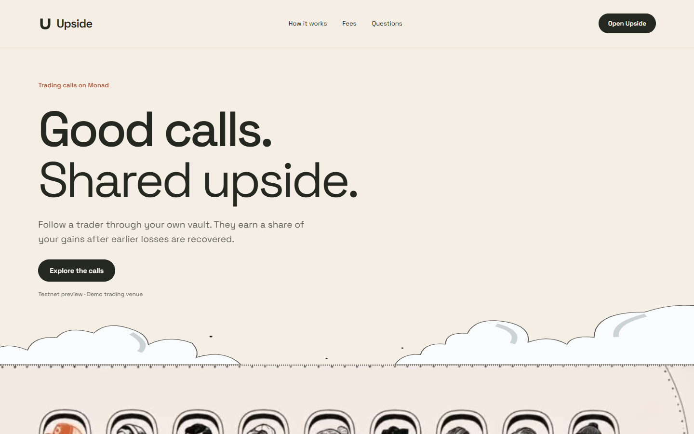
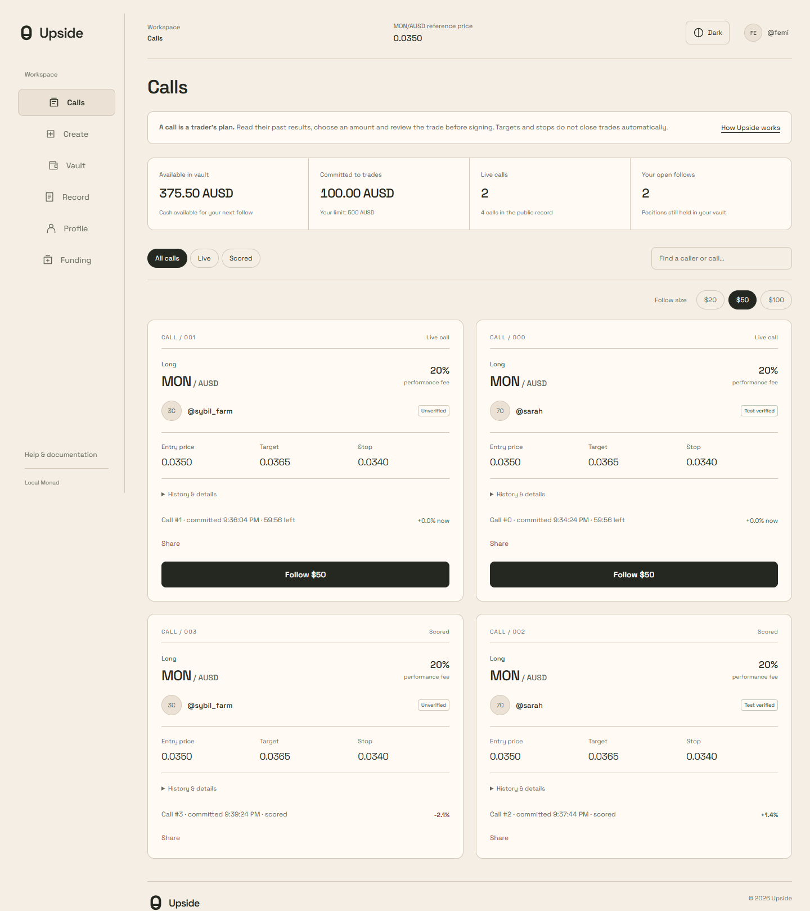
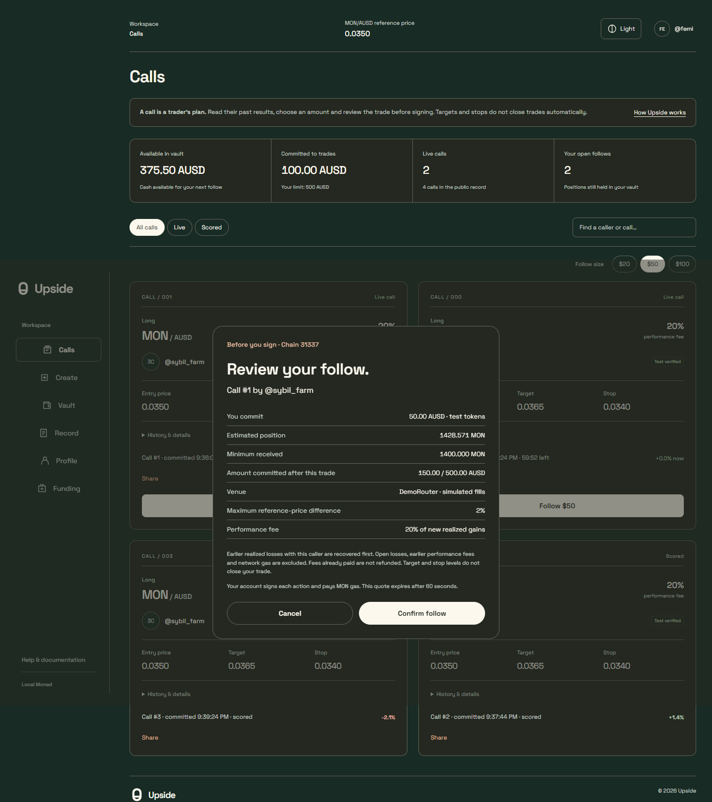
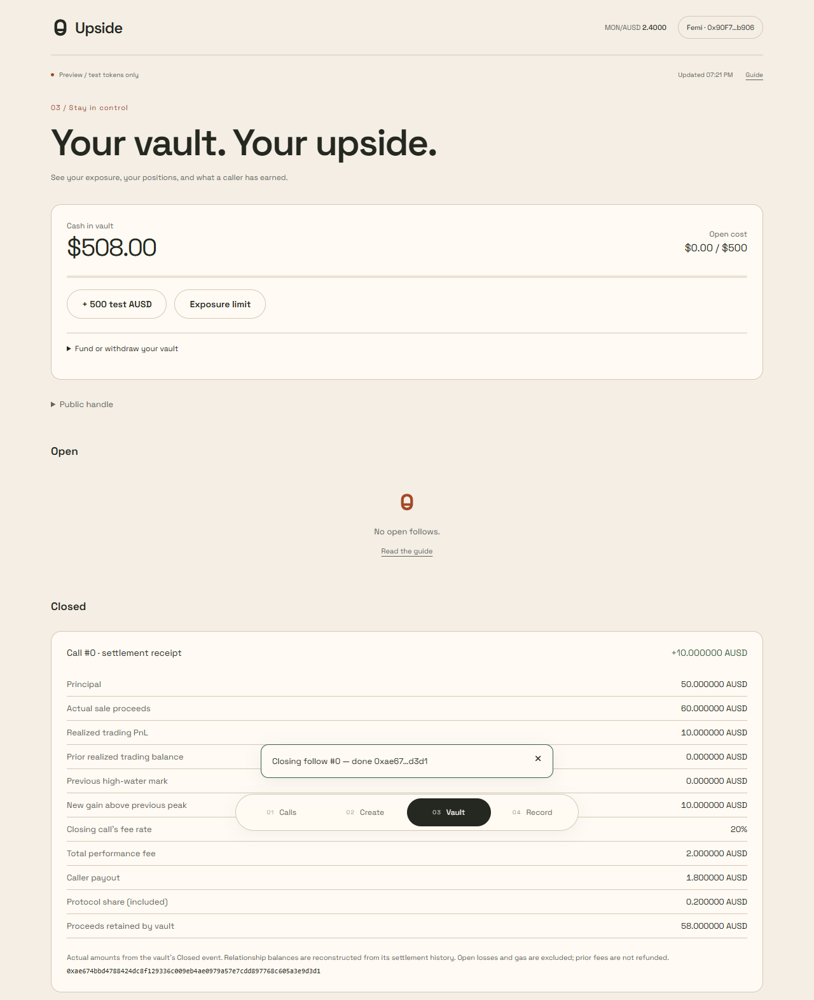
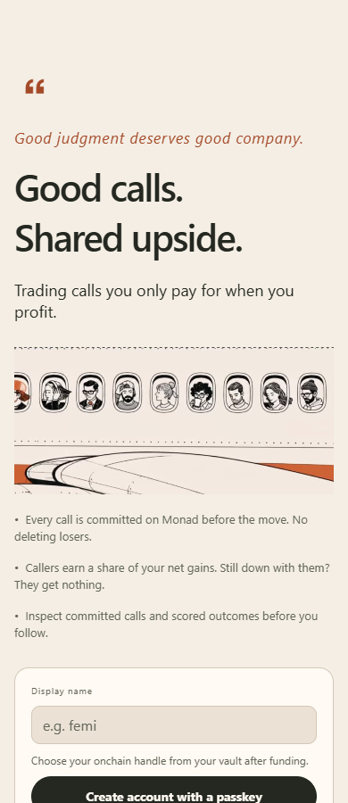
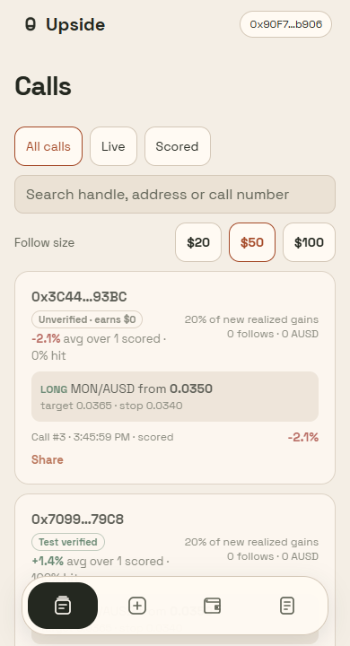
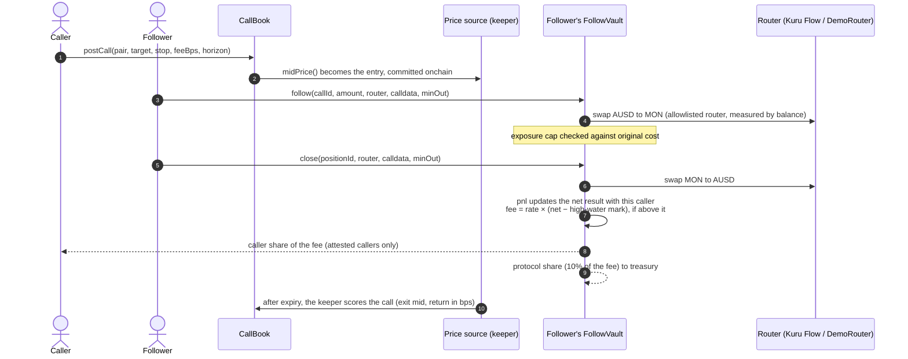
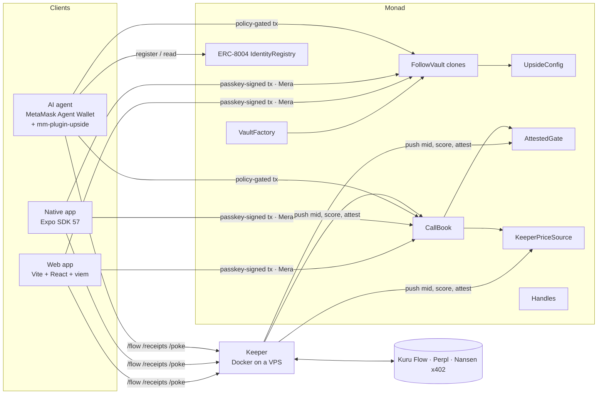

<p align="center">
  
</p>

<h1 align="center">
  &nbsp;Upside
</h1>

<p align="center">
  <b>Good calls. Shared upside.</b><br>
  Follow a trader's public call through your own vault on Monad.<br>
  They earn a share of your <i>realized gains</i>, and only after your earlier losses with them are recovered.
</p>

<p align="center">
  <a href="https://onlyupside.xyz"></a>
  
  
  
  
  
  <a href="LICENSE"></a>
</p>

<p align="center">
  <a href="https://onlyupside.xyz">Live app</a> ·
  <a href="https://expo.dev/artifacts/eas/iAQs6TYQNS023RhtCFu97wbGSmXsYB10jNZF0pBSqOs.apk">Android APK</a> ·
  <a href="docs/demo/round-trip-local.webm">Demo recording</a> ·
  <a href="docs/submission.md">Submission</a> ·
  <a href="mm-plugin/README.md">MetaMask plugin</a>
</p>

---

## Contents

- [The problem](#the-problem)
- [How Upside works](#how-upside-works)
- [Screenshots](#screenshots)
- [Try it now](#try-it-now)
- [How the money moves](#how-the-money-moves)
- [Architecture](#architecture)
- [Smart contracts](#smart-contracts)
- [Apps and services](#apps-and-services)
- [Sponsor integrations](#sponsor-integrations)
- [Run it locally](#run-it-locally)
- [Deploy](#deploy)
- [Verification and evidence](#verification-and-evidence)
- [Trust assumptions and known limits](#trust-assumptions-and-known-limits)
- [Repository layout](#repository-layout)
- [License](#license)

---

## The problem

Paid trading signals charge whether you win or lose. Track records are screenshots: losers get deleted, winners get reposted, and follower counts can be bought. A subscriber pays up front and carries all of the risk.

## How Upside works

| | |
| --- | --- |
| **1. Calls are committed before the move** | A caller posts a call on Monad: pair, direction, target, stop, fee rate and horizon. The entry is the market mid at that moment. Calls can't be edited, backdated or deleted, and every one expires and is scored, losers included. |
| **2. You follow from your own vault** | Each follower gets a personal vault (a minimal clone). Follows and closes swap through allowlisted routers inside that vault, with an onchain exposure cap that you set. Funds never sit with the caller. |
| **3. Callers are paid from realized gains** | When you close, the vault settles against your running result *with that caller*. Earlier closed losses are recovered first, and the fee applies only to new gains above your previous peak (a per-caller high-water mark). Still down with them? They earn nothing. |
| **4. Scores come from prices, not popularity** | A call's score is the move in the market mid from posting to scoring. Follower count, follow volume and reviews are not inputs, so a farm of fake followers can't buy a record. |
| **5. Only attested callers earn** | Fees go only to callers with a current attestation in `AttestedGate` (designed for a Cleanverse A-Pass). Unverified callers can post, and their record is public, but they earn $0. |

## Screenshots

<table>
  <tr>
    <td colspan="2"></td>
  </tr>
  <tr>
    <td width="50%"><br><sub><b>Calls workspace.</b> Vault cash, open exposure against your cap, live and scored calls, verified and unverified callers.</sub></td>
    <td width="50%"><br><sub><b>Review before signing.</b> Amount, minimum received, exposure after, venue, price tolerance and the exact fee rule. Cancel sends nothing.</sub></td>
  </tr>
  <tr>
    <td width="50%"><br><sub><b>Settlement receipt.</b> 50 → 60 AUSD: 10 above the previous peak, 20% fee = 2 AUSD (1.8 to the caller, 0.2 protocol). Read from the vault's <code>Closed</code> event.</sub></td>
    <td width="50%">
      <table>
        <tr>
          <td></td>
          <td></td>
        </tr>
      </table>
      <sub><b>Native app (Expo).</b> Passkey onboarding and the calls feed with records, fees and follow sizes.</sub>
    </td>
  </tr>
</table>

More screens, at 1440, 390 and 320 px and in four themes, are in [`docs/design/screens`](docs/design/screens).

## Try it now

| | |
| --- | --- |
| **Web app** | **https://onlyupside.xyz** (primary website; original accounts remain accessible on `upside-monad.vercel.app`). Read the documentation, then sign in or create an account with a passkey: no seed phrase, and the account is derived on your device with Mera. |
| **Android** | [Signed preview APK](https://expo.dev/artifacts/eas/iAQs6TYQNS023RhtCFu97wbGSmXsYB10jNZF0pBSqOs.apk) ([build details](https://expo.dev/accounts/iamharrie/projects/upside/builds/4c90a59c-b38c-43ab-a1f3-4db5c58b8871), [test sheet](docs/phone-test.md)) |
| **Network** | Monad testnet (chain `10143`). Test AUSD, a demo router and keeper-generated prices. This is real onchain execution with test assets, not a live market. |
| **Keeper API** | `https://keeper.38.49.210.22.sslip.io` (`/flow`, `/receipts`, `/poke`, `/perpl/context`, `/nansen`) |

The testnet venue is seeded with three demo personas, so the feed, leaderboard and receipts show real activity:

| Persona | Role | Address |
| --- | --- | --- |
| `@sarah` | Attested caller. Seven scored calls, losses included; her record is whatever the market did. | [`0xE902…de03`](https://testnet.monadvision.com/address/0xE902aDdcB27e3a94e03956CD640B9844918ede03) |
| `@sybil_farm` | Unverified caller. One call with seven fake follower wallets and $700 behind it, which changes neither its score nor its earnings ($0). | [`0x47Ab…7dE2`](https://testnet.monadvision.com/address/0x47Ab979DDC3C8b3808b2a15c5705BAF5754D7dE2) |
| `@femi` | Follower. Closed a small loss on one of Sarah's calls, so Sarah earned nothing, and holds a position on another. | [`0x2783…1260`](https://testnet.monadvision.com/address/0x2783A70056f52dBff0Bf28FFE9227e16986D1260) |

**Recorded hosted round trip (call 11):** [follow](https://testnet.monadvision.com/tx/0xba660f9fc12533021c598dc10b49d2d743a1cb0e88394fe7618affb05b52f631) → [close](https://testnet.monadvision.com/tx/0x8db57557cfd52bc27bbd641714efc35e7310207b408600de3cf3a478fc648c94) → [withdraw](https://testnet.monadvision.com/tx/0x78e8f54ddd6a5c6955907cb6701dc15fa76848af759c4f73b3a633685640aec5). It closed at a one-raw-unit loss, so the fee was zero. Full record: [`hosted-testnet-results.json`](docs/design/hosted-testnet-results.json).

## How the money moves



**Worked example (from the local end-to-end test):**

| Step | Trade | Net with caller | Previous peak | Fee |
| --- | --- | ---: | ---: | ---: |
| 1 | Follow 50 AUSD, close for 60 | +10 | 0 | **2.00** at 20% (1.80 caller, 0.20 protocol) |
| 2 | Next follow closes at a loss | below +10 | +10 | **0** |
| 3 | Partial recovery, still under the peak | below +10 | +10 | **0** |

Open losses and gas aren't counted until a position closes, and fees already paid are not refunded.

## Architecture



## Smart contracts

Foundry, Solidity 0.8.28, OpenZeppelin 5.1. Source in [`contracts/src`](contracts/src).

| Contract | Role |
| --- | --- |
| `CallBook` | Posts calls on allowlisted pairs (fee ≤ 30%), records the entry mid, scores after expiry, keeps each caller's record (posted, scored, wins, summed return). |
| `VaultFactory` | Deterministic per-owner EIP-1167 clones of `FollowVault`, with a creation-time exposure cap. |
| `FollowVault` | Follows and closes through allowlisted routers, measures proceeds by balance difference, enforces slippage against the mid and the exposure cap, and settles fees with a per-caller high-water mark. |
| `UpsideConfig` | Router allowlist, settlement token, slippage limit, treasury and protocol share. |
| `AttestedGate` | Time-bounded caller attestations (Cleanverse A-Pass in API mode; mock mode on demo venues only). |
| `KeeperPriceSource` | Keeper-pushed mids with a staleness limit; `CallBook` accepts any `IPriceSource`. |
| `Handles` | Unique public handles (`@sarah`) for accounts. |
| `demo/DemoRouter`, `demo/DemoToken` | Testnet-only router that fills at the mid, and faucet tokens. |

**Protections, each covered by a test** ([`Upside.t.sol`](contracts/test/Upside.t.sol), 21 tests in total):

| Property | Test |
| --- | --- |
| Earlier losses are recovered before any fee | `test_highWaterMark_lossesRecoveredFirst` |
| Sale proceeds can't be routed elsewhere to dodge the fee | `test_redirectingProceedsReverts` |
| Base tokens backing an open position can't be withdrawn | `test_lockedBaseCannotBeWithdrawn` |
| A vault refuses follows beyond its own cap | `test_exposureLimit` |
| Fake followers don't move a call's score | `test_fakeFollowersDoNotMoveScore` |
| Unverified callers earn $0 and aren't charged retroactively | `test_unverifiedCallerEarnsNothing` |

Three further tests document current limitations rather than hide them: delayed scoring, stale prices blocking exits, and fees taken while another position is at an unrealized loss.

**Monad testnet deployment** ([`contracts/deployments/10143.json`](contracts/deployments/10143.json)):

| Contract | Address |
| --- | --- |
| CallBook | [`0x618861b1935bc2C2dB6d7F75cA6F3dfC81aac317`](https://testnet.monadvision.com/address/0x618861b1935bc2C2dB6d7F75cA6F3dfC81aac317) |
| VaultFactory | [`0x056426DE47B68b55D9049F373a5bF72436D8ab49`](https://testnet.monadvision.com/address/0x056426DE47B68b55D9049F373a5bF72436D8ab49) |
| AttestedGate | [`0x4894539218Fa5D838Bef29B7658f959aFB63F99b`](https://testnet.monadvision.com/address/0x4894539218Fa5D838Bef29B7658f959aFB63F99b) |
| KeeperPriceSource | [`0x1255E1b9bc0351ea4527aE54dF182aec39f9A941`](https://testnet.monadvision.com/address/0x1255E1b9bc0351ea4527aE54dF182aec39f9A941) |
| UpsideConfig | [`0x3Ff4b179E8389D02C3df9fa37822C230984d54d1`](https://testnet.monadvision.com/address/0x3Ff4b179E8389D02C3df9fa37822C230984d54d1) |
| Handles | [`0x069453f5c4Fa2e112B40de44E3F8Fab9AD08c561`](https://testnet.monadvision.com/address/0x069453f5c4Fa2e112B40de44E3F8Fab9AD08c561) |

## Apps and services

### Web app — [`app/`](app)
Vite, React and viem. It has a public landing page, documentation, and a passkey-gated trading workspace (Calls, Create, Vault, Record, Profile, Funding) in four themes.
- Every write is prepared read-only, shown in a review sheet, and sent only after confirmation. Expired quotes, a changed account and missing gas are refused before signing.
- On Monad, a refresh's contract reads go through Multicall3, so each viewer stays well under public RPC rate limits.

### Native app — [`mobile/`](mobile)
Expo SDK 57 for iOS and Android. It shares the web app's contract logic and adds native passkeys (`react-native-passkey` with Mera), separate onboarding and dock navigation. A signed APK is built with EAS, and passkey association files are served from the web domain.

### MetaMask Agent Wallet plugin — [`mm-plugin/`](mm-plugin)
`mm upside …` lets an AI agent follow attested callers within limits you set. A follow happens only if all four of these allow it:
1. the caller's onchain record;
2. your rules: attested only, minimum scored calls, win rate, maximum fee, call freshness, per-call size and daily budget;
3. the vault's onchain exposure cap;
4. your Agent Wallet policy, which can ask you to approve.

```
mm upside calls | caller <addr> | vault | deposit | follow <id> | close <id> | autopilot
mm upside agent register | agent show <id>   # ERC-8004 identity that publishes the agent's mandate
mm upside intel <addr>                       # Nansen Smart Money check, paid over x402
```
Details: [`mm-plugin/README.md`](mm-plugin/README.md) and the agent skill [`SKILL.md`](mm-plugin/skills/upside/SKILL.md).

### Keeper — [`keeper/`](keeper)
A Node service that runs in Docker behind Caddy ([`deploy/`](deploy)). It:
- pushes prices on demand, while apps are open and before scoring;
- scores calls after expiry and attests callers;
- indexes follows and settlement receipts in 100-block chunks, because public RPCs cap `eth_getLogs`;
- proxies Kuru Flow quotes, Perpl market context and Nansen labels.

Its gas is metered against a daily cap, so a public `/poke` endpoint can't drain it.

### Indexer — [`indexer/`](indexer)
Envio HyperIndex v3 indexer for calls, caller records, vaults, follows and settlements. Vaults are registered dynamically from `VaultCreated`. It runs on the VPS (Postgres + Hasura + indexer as Docker containers, [`deploy/deploy-indexer.sh`](deploy/deploy-indexer.sh)) and serves a public, read-only GraphQL API:

```bash
curl https://indexer.38.49.210.22.sslip.io/v1/graphql -H 'content-type: application/json'   -d '{"query":"{ Caller(order_by:{posted:desc}) { id posted scored wins sumReturnBps } }"}'
```

## Sponsor integrations

Each row says what is built and what has actually been proven.

| Integration | What Upside does with it | Status |
| --- | --- | --- |
| **Monad** | Contracts, passkey accounts and agent flows on Monad testnet; Multicall3 batching | Live on testnet with a recorded hosted round trip |
| **Kuru** | Kuru Flow is the mainnet execution venue; its quotes provide the mid | Mainnet-fork round trip with live Kuru Flow calldata (bought 322.2 WMON for 10 AUSD, sold for 9.993) |
| **Agora (AUSD)** | Settlement asset for vaults, fees and payouts | Contracts parameterised on AUSD; testnet uses a 6-decimal stand-in |
| **Mera** | Passkey PRF → BIP-44 account → viem signing session, on web and native | Working on web; Android association published; physical-device test pending |
| **MetaMask** | Agent Wallet plugin, agent skill and policy-gated writes | Installs in `mm` 7.0.0; core flows tested locally; live Guard Mode recording pending |
| **ERC-8004** | Agent identity whose registration publishes its mandate | Verified against the official registry on a Monad testnet fork |
| **x402 / Nansen** | Smart Money checks paid in USDC on Monad, with price, network and daily budget guards | Payment signed and verified up to Nansen's facilitator; funded settlement pending |
| **Perpl** | "Skin in the game" badge: is the caller long or short MON on Perpl right now? | Read live from Perpl mainnet positions |
| **Envio** | HyperIndex indexer for the feed, records, vaults and settlements, with a public GraphQL API | **Running:** full testnet history indexed from the deploy block; caller records and vault count match the chain exactly, and new calls appear within seconds |
| **Cleanverse** | `AttestedGate` driven by A-Pass status | API adapter written; demo uses mock attestations |

## Run it locally

Requires Node 22+ and [Foundry](https://getfoundry.sh).

```bash
# contract dependencies (first time)
cd contracts && forge install foundry-rs/forge-std OpenZeppelin/openzeppelin-contracts@v5.1.0 --no-git && cd ..

# 1. local chain
anvil --port 8547

# 2. deploy demo contracts, export ABIs, attest the demo caller, set handles
bash scripts/setup-local.sh

# 3. keeper (Anvil's public test key #0)
cd keeper && npm install && KEEPER_KEY=0xac0974bec39a17e36ba4a6b4d238ff944bacb478cbed5efcae784d7bf4f2ff80 npm start

# 4. web app at http://localhost:5173
cd app && npm install && npm run dev
```

On the local chain the sign-in screen offers three demo accounts: **Sarah** (attested caller), **Sybil Farm** (unverified) and **Femi** (follower). Post a 2-minute call as Sarah, follow it as Femi, close it, and watch the keeper score it.

| Check | Command |
| --- | --- |
| Contract tests | `cd contracts && forge test` |
| Plugin end-to-end on Anvil | `cd mm-plugin && npm run test:local` |
| ERC-8004 + x402 checks | `cd mm-plugin && npx tsx scripts/identity-x402-test.ts` (needs a Monad testnet fork on `:8549`) |
| Mainnet-fork Kuru round trip | `cd keeper && CHAIN_ID=31338 RPC_URL=http://127.0.0.1:8548 KEEPER_KEY=<anvil key> npx tsx src/fork-test.ts` |
| UI and QA suites | see [`scripts/qa/README.md`](scripts/qa/README.md) |

## Deploy

**Testnet contracts.** Use a fresh deployer wallet funded with testnet MON. The key is read from your environment and never committed.

```bash
DEPLOYER_KEY=0x... bash scripts/deploy-testnet.sh
node scripts/sync-mobile.mjs     # ABIs and addresses for web, mobile and the MetaMask plugin
```

**Keeper** (Docker + Caddy on any VPS). The key is stored only in a root-readable env file on the server.

```bash
VPS=root@<host> SSH_KEY=~/.ssh/<key> KEEPER_HOST=keeper.<domain> \
ALLOWED_ORIGIN=https://<web-app-domain> bash deploy/deploy-keeper.sh
```

**Web app** (any static host; production uses Vercel):

```bash
cd app && VITE_CHAIN_ID=10143 VITE_KEEPER_API=https://keeper.<domain> npm run build   # serve app/dist
```

**Mainnet.** Deploy with `DEMO=false`, AUSD as `SETTLEMENT_TOKEN`, WMON as `BASE_TOKEN` and the Kuru Flow router `0xb3e6778480b2E488385E8205eA05E20060B813cb`. The keeper then prices from Kuru quotes and serves the quote proxy.

## Verification and evidence

| Document | What it covers |
| --- | --- |
| [`docs/submission.md`](docs/submission.md) | Submission text and the integration claims table |
| [`docs/priority-work-status.md`](docs/priority-work-status.md) | What was built, tested and still pending |
| [`docs/design/README.md`](docs/design/README.md) | Page-by-page design review and QA evidence (web and native) |
| [`docs/design/hosted-testnet-results.json`](docs/design/hosted-testnet-results.json) | Hosted testnet round trip, with transaction hashes |
| [`docs/keeper-score-exit-decision.md`](docs/keeper-score-exit-decision.md) | Keeper, scoring and exit trust boundaries |
| [`docs/phone-test.md`](docs/phone-test.md) | Android/iPhone install and acceptance sheet |
| [`docs/demo/`](docs/demo) | Video script, shot list and a local recording |
| [`brand/README.md`](brand/README.md) | Identity, type, colour tokens and artwork provenance |

## Trust assumptions and known limits

This is a hackathon prototype and **has not been audited**.

- **Prices are keeper-posted.** `KeeperPriceSource` trusts a keeper with a 10-minute staleness limit. A stale price blocks exits until it's refreshed. Any `IPriceSource`, such as a Kuru order-book adapter, can replace it.
- **Scoring happens after expiry, when someone scores.** The keeper scores within seconds, but the exit is the mid at scoring time, not a historical observation at expiry.
- **Administrator configuration is trusted.** That covers the router allowlist, attesters, treasury and protocol share.
- **The fee rule is per caller.** Fees use realized results and the closing call's rate. Open losses and gas are excluded, and fees already paid aren't refunded.
- **Agent budgets are local.** The plugin's daily allowance lives in the client. Only the vault's exposure cap is enforced onchain.
- **Spot and long only** for vault follows.
- **Reputation isn't Sybil-proof.** Scores ignore followers, but nothing proves a caller is one person beyond their attestation.

## Repository layout

```
upside/
├── contracts/     Foundry: CallBook, FollowVault, VaultFactory, UpsideConfig, AttestedGate,
│                  KeeperPriceSource, Handles, demo/ (testnet router + tokens), 21 tests
├── app/           Web app: landing, docs, passkey-gated workspace (Vite + React + viem)
├── mobile/        Native app (Expo SDK 57), shares contract logic with the web app
├── mm-plugin/     MetaMask Agent Wallet plugin + agent skill (ERC-8004, x402)
├── keeper/        Price pushes, scoring, attestations, receipts index, sponsor proxies
├── indexer/       Envio HyperIndex config, schema and handlers
├── deploy/        Keeper Dockerfile, Caddy site, VPS deploy script
├── scripts/       Local setup, testnet deploy, ABI/address sync, QA suites
├── brand/         Identity guide and tokens
└── docs/          Submission, reviews, evidence, phone tests, demo materials
```

## License

[MIT](LICENSE) © 2026 Harrie (IamHarrie-Labs). Third-party fonts and artwork keep their own licenses: Space Grotesk is under the SIL Open Font License ([`app/public/fonts/OFL.txt`](app/public/fonts/OFL.txt)), and artwork provenance is in [`app/public/art/README.md`](app/public/art/README.md).

---

<p align="center">
  Built for <b>Monad Metropolis 2026</b> · Track 03: Social, Attention &amp; Culture
</p>
